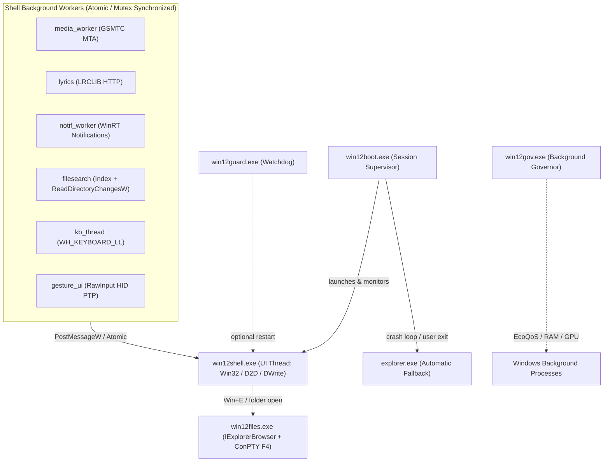

<h1 align="center">AetherRS</h1>

<p align="center">
  <strong>One native Rust desktop shell. Glass surfaces over Direct2D. Reversible down to the last registry key.</strong>
</p>

<p align="center">
  A lightweight custom Windows 10/11 shell featuring a floating segmented dock, a live media and synced-lyrics notch,
  a tabbed file manager with an embedded ConPTY terminal, and a non-admin background resource governor — built without Electron or .NET.
</p>

<p align="center">
  <a href="https://github.com/AndroLay/AetherRS/actions/workflows/ci.yml"></a>
  
  
  
  
  
</p>

<p align="center">
  <a href="#why-aetherrs">Why AetherRS</a> ·
  <a href="#features">Features</a> ·
  <a href="#components--footprint">Components</a> ·
  <a href="#architecture">Architecture</a> ·
  <a href="#shortcuts">Shortcuts</a> ·
  <a href="#quick-start">Quick Start</a> ·
  <a href="#safety--recovery">Safety &amp; Recovery</a> ·
  <a href="CHANGELOG.md">Changelog</a>
</p>

> **Current stage: active development (v0.1.0).**
> `cargo check --lib --bins`, `cargo build --release --bins`, and all 14 parity/logic test suites pass locally.
> Side-by-side mode (with Explorer running) is ready for daily use; full `--shell` replacement mode and `Winlogon\Shell` takeover remain gated behind explicit opt-in (`WINLOGON_WRITE_ENABLED = false`).

---

## Why AetherRS

Stock Windows shell components (`explorer.exe`, `SearchHost`, `ShellExperienceHost`) bundle heavy XAML/WebView layers, consume hundreds of megabytes of RAM, and offer limited desktop ergonomics. AetherRS adds a fast native Rust layer on top of Windows without breaking everyday apps, shell extensions, or fullscreen games.

| Limitation in stock Windows | What AetherRS provides |
| --- | --- |
| Heavy shell footprint & bloated taskbar | Native Win32 + Direct2D/DirectWrite shell; all 5 release binaries total **2.96 MB** |
| No live top-edge media/status hub | Interactive **Notch** with GSMTC playback controls, album art, volume/brightness HUD, and synced **LRCLIB lyrics** |
| Slow File Explorer without an integrated terminal | **AetherRS Files** (`win12files.exe`): `IExplorerBrowser` compatibility (keeps native context menus & shell extensions) + tabs, breadcrumbs, folder watcher, and an embedded **F4 ConPTY terminal** |
| Aggressive background apps competing for RAM/GPU | **Resource Governor** (`win12gov.exe`): non-admin EcoQoS, memory, and GPU priority control with a game & anti-cheat allowlist |
| Risky shell replacements that lock users out | **Reversible by design**: `win12boot` falls back to `explorer.exe` automatically on crash loops, plus `uninstall-win12-rust.ps1 -DryRun` |

---

## Features

### Floating Dock, Glass Surfaces & Start Menu
- **Direct2D / DirectWrite rendering** with Mica/glass backdrop sampling, adaptive light/dark palettes, and DPI PerMonitorV2 awareness.
- **Segmented floating dock pills** with drag-and-drop reordering, pinned apps (`apps.txt`), live running indicators, DWM hover previews, and automatic hiding during fullscreen apps/games.
- **Custom Start menu** with indexed local file search (`files.idx` + `ReadDirectoryChangesW`), app catalog, context actions, and NectarLink status integration.
- **System overlays & utilities**: DWM live-thumbnail `Alt+Tab` switcher, Quick Settings (volume, WMI brightness, Wi-Fi/Bluetooth WinRT radios), battery history flyout, calendar, desktop icons, clipboard history (`Win+V`), emoji picker (`Win+.`), area screenshot (`Win+Shift+S`), and Precision Touchpad HID gestures.

### Interactive Notch (Media, Lyrics & HUD)
- Dedicated MTA background worker (`media_worker.rs`) using typed WinRT GSMTC APIs for playback state, album art decoding, seek/prev/next controls, and bounded logging.
- **Synced lyrics** (`lyrics.rs`) fetched asynchronously from LRCLIB and displayed in real time on the media island.
- Clean volume, brightness, power, and battery alerts without duplicate Windows OSD popups.

### AetherRS Files (`win12files.exe`)
- Built on `IExplorerBrowser` so Windows context menus, OneDrive icons, thumbnails, and third-party shell extensions continue to work natively.
- Custom titlebar tabs, clickable breadcrumb bar with subfolder dropdowns, per-folder view-state persistence, live folder change watcher, and background indexed search.
- **Embedded ConPTY terminal (`F4`)** with bidirectional working-directory sync (OSC 7 / OSC 9;9) — switching folders in the file manager follows in the shell and vice versa.

### Game & Anti-Cheat Awareness
- Detects fullscreen games (`GAME_FS`) and bypasses non-essential keyboard hook logic and periodic `WH_KEYBOARD_LL` re-installation while gaming outside `--shell` mode.
- Automatically recenters Windows modal system pickers (`OpenWith.exe` "Just once / Always", `PickerHost.exe`, `CredentialUIBroker.exe`) when they fall back to `(0, 0)` while Explorer's taskbar is hidden.
- `win12gov.exe` maintains an explicit immunity list for games, launchers, and anti-cheat processes.

---

## Components & Footprint

Release builds use `opt-level = "s"`, `lto = "thin"`, `codegen-units = 1`, and `strip = true` (retaining `panic = "unwind"`).

| Binary | Before Tuning | Current Release | Reduction | Role |
| --- | ---: | ---: | ---: | --- |
| `win12shell.exe` | 5,421.4 KB | **1,385.0 KB** | -74.5% | Main shell UI, dock, notch, Start, flyouts, hotkeys, gestures |
| `win12files.exe` | 5,420.4 KB | **523.0 KB** | -90.4% | Tabbed file manager (`IExplorerBrowser`) + embedded ConPTY terminal |
| `win12gov.exe` | 5,502.7 KB | **433.0 KB** | -92.1% | Non-admin EcoQoS / memory / GPU background resource governor |
| `win12boot.exe` | 5,475.2 KB | **338.0 KB** | -93.8% | Full `--shell` session supervisor with automatic Explorer fallback |
| `win12guard.exe` | 5,431.1 KB | **282.5 KB** | -94.8% | Lightweight crash watchdog (max 3 restarts / 2 minutes) |
| **Total** | **27,250.8 KB** | **2,961.5 KB** | **-89.1%** | Complete 5-binary suite |

---

## Architecture



### Repository Layout

```text
src/
  bin/          Entry points for the 5 binaries (win12shell, win12files, win12boot, win12gov, win12guard)
  shell/        Direct2D/Win32/WinRT shell UI, dock, notch, Start, flyouts, overlays, and workers
  files/        AetherRS Files UI, custom chrome, IExplorerBrowser host, ConPTY terminal, and watcher
  *.rs          Pure logic modules (query, search, nl_json, ui_logic, fm_logic, tasks_logic, stophosts, sync, reg, log)
tests/          14 in-memory parity and logic test suites (never mutate live OS state)
.github/        GitHub Actions CI (PowerShell AST syntax check, cargo check, cargo test)
```

---

## Shortcuts

| Shortcut | Action |
| --- | --- |
| `Win` / `Ctrl+Esc` | Toggle AetherRS Start menu |
| `Win+S` | Open Start menu focused on search |
| `Win+E` | Open AetherRS Files (`win12files.exe`) |
| `Win+A` / `Win+N` | Open Quick Settings / Calendar & Notifications |
| `Win+V` / `Win+.` | Open Clipboard History / Emoji Picker |
| `Win+D` / `Win+X` | Show Desktop / Power User menu |
| `Win+Arrow` | Snap active window |
| `Win+Shift+S` | Area screenshot tool |
| `Alt+Tab` | DWM live-thumbnail task switcher |
| `F4` / `Ctrl+\`` *(in Files)* | Toggle embedded ConPTY terminal / switch terminal focus |

---

## Quick Start

### Prerequisites
- Windows 10 or 11 (x64)
- Rust stable toolchain with `x86_64-pc-windows-gnu` target
- MSYS2 / MinGW-w64 (`windres.exe` in `C:\msys64\ucrt64\bin` or `PATH`)

### Build & Verify

```powershell
# Type-check library and all 5 binaries (-j 2 keeps laptop thermals low)
cargo check --lib --bins -j 2

# Run all 14 in-memory test suites
cargo test -j 2

# Build stripped, LTO-optimized release binaries
cargo build --release --bins -j 2
```

### Deploy & Package

```powershell
# Install built release binaries to local install\ directory
# Optional flags: -SkipBuild, -KeepBackups 5, -RestorePoint (Admin)
powershell -NoProfile -ExecutionPolicy Bypass -File .\deploy-win12-rust.ps1 -SkipBuild

# Package a binary-only public release (.zip + SHA256SUMS.txt) into dist\
# Excludes all .rs source files and internal notes
powershell -NoProfile -ExecutionPolicy Bypass -File .\pack-release.ps1 -Version 0.1.0
```

---

## Safety & Recovery

- **Non-destructive by default:** `deploy-win12-rust.ps1` stops the previous shell via `--exit` (no forced `Stop-Process`), verifies SHA-256 hashes after copy, rotates old backups (`-KeepBackups 5`), and supports optional Windows System Restore Points (`-RestorePoint`).
- **One-command revert to Explorer:**

```powershell
# Preview every action without modifying the system
powershell -NoProfile -ExecutionPolicy Bypass -File .\uninstall-win12-rust.ps1 -DryRun

# Gracefully stop AetherRS, restore folder associations, autostart, Winlogon\Shell, and Explorer
powershell -NoProfile -ExecutionPolicy Bypass -File .\uninstall-win12-rust.ps1
```

User configuration files in `install\` (`settings.ini`, `apps.txt`, `widgets.ini`) are preserved during uninstall.

---

## License

Copyright (c) 2026 AndroLay. All rights reserved. See [LICENSE](LICENSE).
